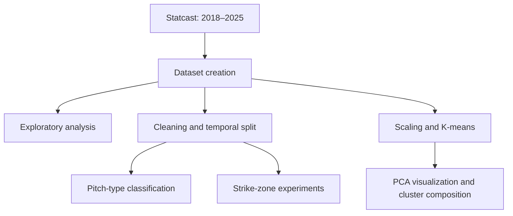

# MLB Pitch Analysis with PySpark

A notebook-based study of MLB Statcast pitches from the **2018–2025 regular seasons**, developed for Distributed Data Analysis and Mining. The project combines exploratory analysis, supervised classification, and unsupervised clustering to examine how pitch physics and game context relate to pitch type and strike-zone outcomes.

**Stack:** Python · Apache Spark / MLlib · pybaseball · pandas · Matplotlib · Parquet

## Questions explored

- How do pitch selection and pitch characteristics vary across seasons, ball–strike counts, and pitcher–batter handedness?
- How well can pitch types be classified from their measured speed, movement, spin, and release geometry?
- How much information about pitch selection is available from game context when pitch measurements are removed?
- How do plate location and pitch trajectory relate to called strikes and geometric strike-zone membership?
- Do clusters built from physical measurements resemble the recorded pitch categories?

## Project map



The notebooks use Spark DataFrames and MLlib for preparation and modeling. They are configured for local Spark execution; plotting uses Matplotlib, with small samples converted to pandas where needed.

## 1. Build and explore the dataset

[dataset_creation.ipynb](dataset_creation.ipynb) downloads one season at a time through pybaseball, retains regular-season games, saves yearly Parquet files, and merges them into `data/full_dataset.parquet/`. Processing each season separately avoids holding the entire multi-season dataset in pandas at once.

[EDA.ipynb](EDA.ipynb) examines:

- Dataset coverage, schema, missing values, and numerical feature correlations.
- Pitch-type frequencies across seasons and ball–strike counts.
- Pitch selection by pitcher–batter handedness and individual pitcher.
- The available pitch descriptions and event categories.

## 2. Prepare a temporal evaluation

[preprocessing_refined.ipynb](preprocessing_refined.ipynb) checks basic value ranges, deduplicates pitches by game, at-bat, and pitch number, and removes identifiers, deprecated fields, and selected outcome-related columns. Base occupancy becomes a binary indicator, and missing fielding alignments receive an explicit category.

The supervised experiments use **2018–2024 for training and 2025 for testing**, evaluating models on a later season. Categorical encoders and numerical median imputation are fitted using the training split. A flag records whether plate coordinates and strike-zone bounds were observed before imputation, so strike-zone experiments can filter to measured locations.

Preprocessing writes two versions of each split: one retaining pitch measurements and another with those measurements removed. The classification notebooks check that the expected seasons are present before fitting models.

## 3. Compare classification experiments

Each experiment compares **logistic regression, decision trees, and random forests**. Evaluation includes accuracy, weighted F1, weighted precision, and weighted recall, with per-class or macro F1 reports in selected notebooks.

| Notebook | Target | Inputs and purpose |
| --- | --- | --- |
| [Full pitch classification](classification_full_data_helper.ipynb) | Recorded pitch type | Speed, movement, spin, release position, and trajectory measurements across available pitch types |
| [Restricted pitch classification](classification_reduced_dataset_helper.ipynb) | Recorded pitch type | The same physical features, restricted to nine pitch categories for comparison |
| [Contextual pitch classification](classification_nopitch_helper.ipynb) | Recorded pitch type | Game situation, base occupancy, handedness, age, and related context, with pitch measurements removed |
| [Called strike vs. ball](strikeball_helper.ipynb) | Umpire's recorded call | Observed plate coordinates, batter-specific strike-zone bounds, and ball–strike count; only called strikes and balls are retained |
| [Geometric strike-zone classification](strikeball_noplate_helper.ipynb) | Whether the pitch intersects an approximate strike zone | Release and trajectory features, pitch type, handedness, zone bounds, and count; plate coordinates are used to construct the target and excluded from model inputs |

The restricted and contextual experiments retain `FF`, `SI`, `SL`, `CH`, `FC`, `ST`, `CU`, `FS`, and `KC`: four-seam fastball, sinker, slider, changeup, cutter, sweeper, curveball, splitter, and knuckle curve.

The physical-feature classifiers describe a pitch after it has been thrown. The contextual experiment asks a different question about pitch selection. Likewise, an umpire's call and geometric zone membership are separate targets: the geometric definition uses plate width, batter-specific vertical bounds, and an approximate ball radius.

Shared functions in [classification_helper.py](classification_helper.py) configure Spark, assemble feature vectors, fit and evaluate models, and extract tree-model feature importance.

## 4. Explore pitch clusters

[throws_clusters.ipynb](throws_clusters.ipynb) clusters pitches using eight physical measurements: release speed, spin rate, spin axis, horizontal and vertical movement, extension, and horizontal and vertical release position. Horizontal movement is adjusted for pitcher handedness, and the features are standardized before clustering.

The notebook compares **K-means with k=4 and k=5** using silhouette scores, examines the recorded pitch types within each cluster, and summarizes cluster speed, movement, and geometric zone membership. PCA provides a three-dimensional visualization of up to 5,000 sampled pitches. Cluster IDs belong to each fitted model and should be interpreted through their composition and feature profiles.

## Run the project

### Environment

The development environment uses **Python 3.14.7, OpenJDK 21, and PySpark 4.2.0**. Direct dependencies are pinned in [requirements.txt](requirements.txt); [requirements-dev.txt](requirements-dev.txt) also includes the notebook kernel. Transitive dependencies are not locked.

```bash
python -m venv .venv
source .venv/bin/activate
python -m pip install -r requirements-dev.txt
python -m ipykernel install --user --name statcast-pyspark --display-name "Statcast PySpark"
java -version
```

Open the notebooks in a Jupyter-compatible editor and select **Statcast PySpark**. Run from the repository root so relative data paths resolve correctly. Java must be on `PATH`, or configured through `JAVA_HOME`.

### Execution order

1. **Dataset creation** — run `dataset_creation.ipynb`; internet access is required.
2. **Exploration** — run `EDA.ipynb` on the combined dataset.
3. **Preprocessing** — run `preprocessing_refined.ipynb` to create temporal splits.
4. **Classification** — run any of the five classification notebooks.
5. **Clustering** — run `throws_clusters.ipynb`; this needs the combined dataset but does not depend on preprocessing or classification.

Most Spark sessions use two local worker threads and 4 GB of driver memory. Allow several GB of disk space and substantial runtime for the full dataset. Stop the active Spark session before switching notebooks. Dataset creation downloads all configured seasons again when rerun, and dataset creation and preprocessing overwrite their generated outputs.

See [the data guide](data/README.md) for the generated directory layout. Downloaded datasets, caches, virtual environments, and Spark artifacts are excluded from the repository.

### Tests

```bash
SPARK_LOCAL_IP=127.0.0.1 python -m unittest -v test_classification_helper.py
```

The two tests in [test_classification_helper.py](test_classification_helper.py) cover feature assembly, model fitting and evaluation, and feature-importance extraction using small synthetic datasets. They require Java and local socket access, but no Statcast download.

## Interpretation and current scope

- The repository contains the analysis workflow; saved notebook outputs are cleared. Rerun the notebooks to inspect metrics and plots. A complete end-to-end run with the pinned environment has not been validated; the two helper tests pass.
- Pitch classes are imbalanced. Per-class and macro F1 reports help interpret performance alongside weighted metrics.
- The contextual classifier currently uses categorical index columns (`_idx`). Preprocessing also creates one-hot vectors (`_ohe`), which are used in other experiments.
- PySpark emits a compatibility warning for the pinned pandas 3.x version. Spark-to-pandas operations need validation during a full notebook run.
- Statcast data and upstream schemas may change between downloads, affecting reproducibility. Data is obtained through pybaseball and remains subject to the source providers' terms.
